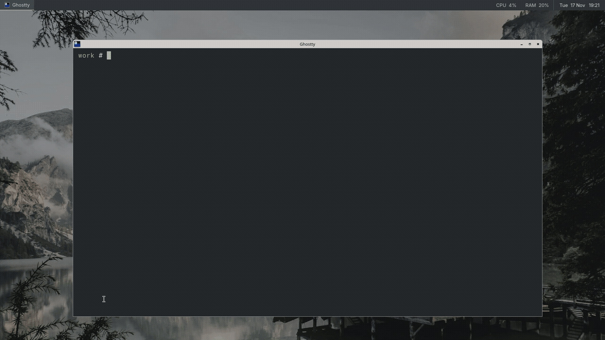

vncat - VNC in your terminal
===========================

View and control a VNC desktop without leaving the terminal.



## REQUIRES

  A terminal with Kitty graphics and pixel size reporting, e.g. Ghostty.

## INSTALL

```text
  go install github.com/reconquest/vncat/cmd/vncat@latest
```

## USE

```text
  ./vncat :5900       Draw one image and exit.
  ./vncat -R :5900    Watch, without sending input.
  ./vncat -X :5900    Control with keyboard and mouse.
  ./vncat --help      Show all options.
```

  Press Ctrl-] to quit. Ctrl-C goes to the remote desktop in -X mode.

## TMUX

  Requires allow-passthrough on.

## WARNING

  VNC authentication is unencrypted. Use a trusted network or SSH tunnel.

## LICENSE

  MIT
